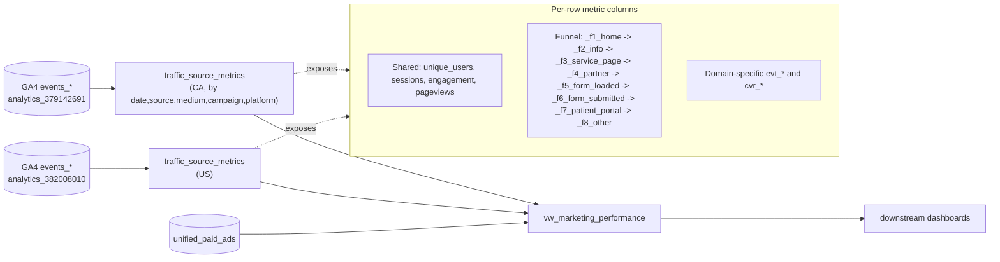

# Funnel-bucket GA4 metrics tables

## Goal

Keep the same three scripts in this folder, the same target tables (`analytics_379142691.traffic_source_metrics` for CA and `analytics_382008010.traffic_source_metrics` for US), the same view (`paid_marketing_data.vw_marketing_performance`), and the same `(date, source, medium, campaign, platform)` grain. The only change: replace the ~25 hard-coded `_<page>` columns and the ad-hoc `_cat_*` rollups in the existing scripts with **8 funnel-stage columns** that are identical on both domains.

## Funnel taxonomy

Each column is `COUNT(DISTINCT user_pseudo_id) WHERE event_name = 'page_view' AND <pattern>` — same convention as the existing `_<page>` columns. Each bucket is **independent**: a single user who hits `/online-doctor-bc/` then `/rd-bc-booking/` then `/thank-you-bc/` in one session is counted in `_f3_service_page`, `_f5_form_loaded`, **and** `_f6_form_submitted`. This matches the existing per-page semantics exactly. Bucket numbering reflects funnel position, not exclusivity.

Bucket naming reflects what is actually happening on the page (no booking happens on these forms — submitting the intake form routes the lead into the patient-portal / care-team pipeline; "thank-you" pages are our proxy for "form submitted").

Patterns below are `LIKE` patterns to be used in `e.page_location LIKE '<pattern>'` (matching the existing scripts), except `_f1_home` which uses `REGEXP_CONTAINS` to anchor to the homepage only. Patterns are **derived from both sitemaps and the GA4 page-list CSV**:

- [XML Sitemap - Rocket Doctor.xml](XML%20Sitemap%20-%20Rocket%20Doctor.xml) — CA sitemap, 198 unique URLs
- [XML Sitemap - Rocket Doctor US.xml](XML%20Sitemap%20-%20Rocket%20Doctor%20US.xml) — US sitemap, 118 unique URLs
- [bquxjob_7d2fcf8c_19dcf492996.csv](bquxjob_7d2fcf8c_19dcf492996.csv) — top 500 URLs by users (includes the `noindex`'d booking / thank-you / patient-portal pages that are deliberately absent from the sitemaps)

A flat one-row-per-bucket version of the table below, designed to share with stakeholders, lives at [funnel_buckets.csv](funnel_buckets.csv).

### `_f1_home` — Home

User landed on the front door.

- CA: `REGEXP_CONTAINS(page_location, r'^https?://(www\.)?rocketdoctor\.ca/?(\?|#|$)')`
- US: `REGEXP_CONTAINS(page_location, r'^https?://(www\.)?rocketdoctor\.io/?(\?|#|$)')`

### `_f2_info` — Brand & info

Corporate / brand / institutional content with no conversion intent (about, careers, partners, technology, terms, privacy, contact root, blog / press releases).

- CA: `%/about/%`, `%/careers/%`, `%/partners/%`, `%/our-technology/%`, `%/a-guide-to-virtual-care/%`, `%/referrals/%`, `%/start-your-virtual-care-practice%`, `%/subscription-plans%`, `%/ai-research-study/%`, `%/savevirtualcare%`, `%/patient-email-communications/%`, `%/rd-devices-terms-and-conditions/%`, `%/test-new-availability/%`, `%/staging-%`, `%/terms-of-use/%`, `%/privacy-policy%`.
- US: `%/about/%` (covers `/about/team/team/<bio>` and `/about/virtual-clinic-locations/`), `%/partners/%`, `%/patients/%` (covers `/patients-2/`), `%/physicians/%`, `%/our-technology/%`, `%/coverage-pricing/%`, `%/feedback/%`, `%/news-blog%`, `%/telehealth-informed-consent/%`, `%/style-guide/%`, `%/terms-of-use%`, `%/terms-of-service%`, `%/privacy-policy%`, `%/bridging-access-to-care/%`, `%/contact/contact-detail/%`, `%/contact/physician-contact/%`, `%/contact/partner-contact/%`. The state-specific `/contact/california/` and `/contact/new-york/` are intentionally **not** here — they have intake forms and live in `_f5_form_loaded`. The ~17 individual press-release / blog post pages with arbitrary root slugs (`/300000-patient-appointments/`, `/launch-of-new-specialist-referrals-system/`, `/voyce/`, `/2010e-psych-eval/`, `/438/`, etc.) deliberately fall through to `_f8_other` since they have no shared prefix.

### `_f3_service_page` — Service pages

Pages describing a Rocket Doctor service (organic SEO + paid). The CA sitemap shows ~150 of these split across city / condition / region / specialty.

- CA, by city: `%/online-doctor-%`, `%/online-doctors-%`, `%/virtual-walk-in-clinic-%`, `%/online-walk-in-clinic-%`, `%/doctors-notes-%`, `%/dermatologists-online-%`.
- CA, by condition / specialty: `%/ontario-%-online%`, `%/ontario-%-treatment-online%`, `%/alberta-%-online%`, `%/alberta-%-treatment-online%`, `%/family-doctor-ontario%`, `%/medical-clinic-ontario%`, `%/virtual-care-ontario%`, `%/virtual-doctor-ontario%`, `%/medication-refills-online-ontario%`, `%/prescription-refills-ontario%`, `%/specialist-referrals-ontario%`, `%/pediatrics-doctors%`, `%/obgyn-ont%`, `%/virtual-adhd-clinic%`, `%/rapid-addictions-medicine-clinic/%`, `%/rapid-addictions-medicine-clinic-ad/%`, `%/addiction-withdrawal-doctor%`.
- CA, by province hub & general CTAs: `%/alberta/`, `%/ontario/`, `%/bc-online-doctor%`, `%/rocket-doctor-bc%`, `%/rocket-doctor-alberta%`, `%/no-ohip/%`, `%/doctor-no-ohip/%`, `%/on-free-with-ohip%`, `%/see-a-doctor%`, `%/see-a-virtual-doctor%`, `%/chat-with-a-doctor%`, `%/telehealth-consultation-canada-lander%`.
- CA, pricing-format landers: `%/chat-55-availability%`, `%/single-chat-74-availability%`, `%/pa-65-availability%`, `%/private-pay-65-availability%`.
- US: `%/online-doctor-california%`, `%/medi-cal-doctors-california-lp%`, `%/medicaid-doctors-maryland%`, `%/medicare-doctors-%`, `%/medi-cal-other-care-plan%`, `%/california-skin-doctors%`, `%/doctors-online-%`, `%/see-online-doctor-%`, `%/mental-health/%`.

### `_f4_partner` — Partner & branded pages

Branded partner programs / individual-doctor profile pages. Default judgement-call assignments (override later if you want):

- `/embrace-program/`, `/genaissance/`, `/synergy-orthopedics/` go here (brand-named partnerships rather than generic services).

Patterns:

- CA: `%/dr-%`, `%/drhoffmann%`, `%/genaissance%`, `%/synergy-orthopedics%`, `%/embrace-program%`, `%/centrum-pharmacy%`, `%/olive-fertility%`, `%/the-reproductive-care-centre%`, `%/ottawa-fertility-centre%`, `%/georgian-bay-general-hospital%`. (`/dr-%` catches `/dr-pillay/` and `/dr-winder-gill/`; `/drhoffmann/` listed separately because it has no hyphen after `dr`.)
- US: `%/acacia%`, `%/agency-name/%`, `%/camba%`, `%/ccah%` (covers `/ccah/` and `/ccah-2/`), `%/consulthealth%`, `%/harlem-united%`, `%/housing-works/%`, `%/pearsuite/%`. The `*-appointment/` variants of these go in `_f5_form_loaded`.

### `_f5_form_loaded` — Intake form loaded

The user opened a booking / appointment / payment form. No submission yet — the actual booking happens downstream in the patient portal / via the care-team contact. Default judgement-call: `/us-payment/` and `/rd-us-pay-for-visit/` are bucketed here rather than split into a separate payment stage.

- CA: `%/rd-%-booking%`, `%/rd-ontario-app%`, `%/uninsured-private-pay-appointment%`, `%/rapid-addictions-medicine-clinic-appt2%`. (`/rd-ontario-app%` catches both `/rd-ontario-app/` and `/rd-ontario-appointment/`.)
- US: `%/california-book-appointment%` (catches `-others` variant), `%/maryland-book-appointment%`, `%/rd-new-york-appointment%`, `%/engagewell-appointment%` (catches mandarin variant), `%/ozempic-appointment%` (catches `-booking` variant), `%/contact/california%`, `%/contact/new-york%`, `%/agency-name-appointment%`, `%/housing-works-appointment%`, `%/pearsuite-appointment%`, `%/usacs-form%`, `%/usacs-survey-form%`, `%/device-submission%`, `%/us-payment%`, `%/rd-us-pay-for-visit%`.

### `_f6_form_submitted` — Form submitted (thank-you)

Confirmation / "thank-you" page reached. Used as the proxy for "user submitted an intake form".

- CA: `%/thank-you-%`, `%/single-chat-thank-you%`, `%/private-pay-thank-you%`.
- US: `%/thank-you-%` (covers all US thank-you variants seen in the sitemap: `-cali-cash-pay`, `-cali-insurance`, `-maryland`, `-ny`, `-payment-received`, `-staging`, `-usa`, `-usa-others`, `-usa-staging-page`, `-usacs`).

### `_f7_patient_portal` — Patient portal

Post-conversion / existing-customer app surfaces. None of these are in the sitemaps (they're separate apps); patterns come from the GA4 CSV and existing SQL.

- CA: `%patient.rocketdoctor.ca%`, `%patient.starship.usacs.com%`.
- US: `%patient.rocketdoctor.us%`, `%us-rocketdoctor.adracare.com%`, `%try.rocketdoctor.io%`.

### `_f8_other` — Other

Sanity catch-all: any `page_view` whose `page_location` did not match any pattern in `_f1`..`_f7`. Computed as `unique_users with page_view AND NOT (any f1..f7 pattern)`. This bucket should be small if coverage is good; we accept that the ~17 US news / press articles with arbitrary slugs (no shared prefix) live here.

## Files to edit

### 1. [traffic_source_metrics.sql](traffic_source_metrics.sql) (CA)

- Keep header comment, partitioning (`PARTITION BY date`), CTEs (`raw_events`, `events`), shared metrics block (`unique_users`, `total_sessions`, `engaged_sessions`, `engaged_session_rate`, `total_pageviews`, `avg_pages_per_session`, `total_engagement_sec`, `avg_engagement_time_sec`, `bounced_sessions`), `landed` / `evt_*` / `cvr_*` columns, `GROUP BY`, `HAVING`, and the entire scheduled-refresh `BEGIN TRANSACTION` block — unchanged.
- Replace lines 87..161 (per-page `_<slug>` columns + `_cat_*` rollups) with the eight `_f*_*` funnel columns above.
- Mirror the same replacement in the scheduled-refresh `INSERT` (lines 267..341) so backfill and incremental stay in sync.

### 2. [traffic_source_metrics_us.sql](traffic_source_metrics_us.sql) (US)

- Same surgery, same eight `_f*_*` columns (with the US-specific patterns inside `_f3_service_page` / `_f4_partner` / `_f5_form_loaded` / `_f7_patient_portal`).
- Keep `CLUSTER BY source, campaign`, the `_TABLE_SUFFIX >= '20200101'` guard, and all `evt_*` / `cvr_*` (`evt_california_lead`, `evt_click_to_call`, `evt_form_submission`, `evt_email_clicks`, `cvr_landed_to_lead`, `cvr_landed_to_call`).
- Mirror in the refresh `INSERT` block.

### 3. [vw_marketing_performance.sql](vw_marketing_performance.sql)

- Both `ga_ca` and `ga_us` CTEs now expose the **same** `_f1_home`..`_f8_other` columns, so the dozens of `CAST(NULL AS INT64) AS _<page>` padding lines on each side disappear.
- The final `SELECT g._<page>, ...` block in the join shrinks to `g._f1_home, g._f2_info, g._f3_service_page, g._f4_partner, g._f5_form_loaded, g._f6_form_submitted, g._f7_patient_portal, g._f8_other`.
- Conversion-event padding (`evt_form_submitted` / `evt_booked` on US side, `evt_california_lead` / `evt_click_to_call` / `evt_form_submission` / `evt_email_clicks` on CA side) stays as-is — those are domain-specific events, not pages.
- The `paid` CTE, source normalisation, and `LEFT JOIN` keys stay unchanged.

## Data flow (unchanged; only the column set changes)

## Notes / non-goals

- **No schema-shape change**: the table is still wide and partitioned by date; downstream readers only see column renames + drops. They will need to update any references to the old `_<slug>` columns.
- **No new tables**: no long-format companion table is being added.
- **Site inventory**: CA patterns are grounded in [XML Sitemap - Rocket Doctor.xml](XML%20Sitemap%20-%20Rocket%20Doctor.xml) (198 URLs); US patterns are grounded in [XML Sitemap - Rocket Doctor US.xml](XML%20Sitemap%20-%20Rocket%20Doctor%20US.xml) (118 URLs). Booking forms, thank-you pages, and `patient.*` portals are intentionally not in the sitemaps (they are `noindex`); coverage of those comes from [bquxjob_7d2fcf8c_19dcf492996.csv](bquxjob_7d2fcf8c_19dcf492996.csv) and the existing SQL.
- **Stakeholder reference**: bucket definitions also exported as a flat CSV at [funnel_buckets.csv](funnel_buckets.csv) for sharing.
- **Backfill**: run the `CREATE OR REPLACE TABLE` block once for each domain; the existing scheduled refresh continues to maintain yesterday + today partitions.
